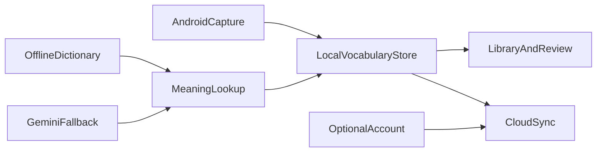

# Stackit toward a premium product

Quality and reliability first; a paid plan only after the free product is something people would pay to keep using. Stay **Android-first**. Do not add in-app purchases in this program. Do not promise iOS capture until the Android core is durable.

## Product bar

A premium language tool does four things without drama:

- Capture a word from another app in one tap, even if the user is not signed in.
- Look it up offline, with AI as optional enrichment that does not fail the save.
- Remember every sense independently, with intervals that actually grow.
- Never lose the library because of a prefs-size or crash-during-write.

Current gaps vs that bar: the library is one SharedPreferences JSON blob ([MainActivity.kt](android/app/src/main/kotlin/app/stackit/stackit/MainActivity.kt), [platform_bridge.dart](lib/data/platform_bridge.dart)); home requires Firebase Auth ([auth_gate.dart](lib/features/auth/auth_gate.dart)); FSRS intervals are clamped to 60 days ([fsrs_scheduler.dart](lib/features/review/fsrs_scheduler.dart) and [firestore.rules](firestore.rules) `intervalDays <= 60`); UI languages include 36 hi/ur/fa routes ([language_pair.dart](lib/models/language_pair.dart)) while cloud rules still allow only `en`/`ar`/`fr`.

## Phase 0 — Freeze the contract (short, no new features)

Lock what the product *is* so later work does not fight itself.

- **Languages shipped:** English, Arabic, French only (including same-language study). Keep Hindi/Urdu/Farsi dictionary assets and pair constants, but hide them behind an explicit experimental flag or remove them from `LanguagePair.supported` until rules, README, and UI match. Update [README.md](README.md) so it stops advertising 9 routes while the code lists 36.
- **FSRS:** `intervalDays` must equal the real day gap from `now` to `nextReviewAt`. Raise the Firestore cap (e.g. 0–3650, not 60). Change the clamp in [fsrs_scheduler.dart](lib/features/review/fsrs_scheduler.dart) and the doubling cap in [review_scheduler.dart](lib/features/review/review_scheduler.dart). Extend [firestore.rules](firestore.rules) and [firestore_rules_contract_test.dart](test/firestore_rules_contract_test.dart). Mastery in [filter_service.dart](lib/data/filter_service.dart) / [vocabulary_controller.dart](lib/features/vocabulary/vocabulary_controller.dart) should use `nextReviewAt` or unclamped `intervalDays`.
- **Platform:** Android is the product. iOS stays a Flutter stub; do not invest in iOS PROCESS_TEXT equivalents yet.
- **Positioning:** Offline dictionary is free and local. Gemini is enrichment (fallback, senses, examples, IPA). Cloud sync is optional backup, not the source of truth.

## Phase 1 — Local durability (the actual premium foundation)

Move the library off Android SharedPreferences.

- Add Dart-side persistence with `path_provider` + **Drift or sqflite** (prefer Drift for typed migrations). Store entries, collections, tags, profile, and prefs as tables, not one JSON string.
- Shrink [PlatformBridge](lib/data/platform_bridge.dart) to capture, clipboard, TTS, and pending-intent handoff only. Delete `loadEntries` / `saveEntries` / `loadLibrary` / profile prefs from Kotlin once Dart owns files.
- One-shot migration: if the old prefs blob exists, import it, then stop writing it.
- Put Gemini cache in the app documents directory, not cwd (`local_dictionary_cache.json` in [local_dictionary_cache.dart](lib/data/local_dictionary_cache.dart)).
- Writes must be atomic (temp file + rename, or SQLite transactions) so a kill during save cannot empty the library.
- Tests: repository round-trip, migration from a fixture prefs JSON, concurrent save+capture.

This is the largest engineering slice and the one that makes the app feel expensive.

## Phase 2 — Capture without an account wall

Premium apps work in the first 30 seconds.

- Allow a **local session**: [AuthGate](lib/features/auth/auth_gate.dart) should open [VocabularyHome](lib/features/vocabulary/vocabulary_home.dart) unsigned, with library on device only.
- Sign-in becomes “backup and sync”, not a gate. Keep Google/email as today.
- First-run: language pair sheet, then a one-screen “how to highlight in Chrome/WhatsApp” using the existing capture matrix in [docs/capture-validation.md](docs/capture-validation.md).
- PROCESS_TEXT while signed out must still open the preview sheet and save locally.
- When the user later signs in, merge local → cloud with the existing conflict rules; never wipe local on login.
- Add an integration-style test for: unsigned capture → save → sign-in → entries still there.

## Phase 3 — Split the god objects (without a framework rewrite)

Keep `ChangeNotifier`. Do not introduce Riverpod/Bloc in this program.

Extract from [vocabulary_controller.dart](lib/features/vocabulary/vocabulary_controller.dart) (~1040 lines) and [vocabulary_home.dart](lib/features/vocabulary/vocabulary_home.dart) (~1340 lines):

- `VocabularyRepository` — CRUD, duplicate merge, collections/tags
- `SyncCoordinator` — [vocabulary_cloud_store.dart](lib/data/vocabulary_cloud_store.dart) + profile store, last-sync UI
- `CaptureCoordinator` — pending payload, language detection, preview save
- `ReviewCoordinator` — due list, FSRS apply, streak/retention (move `computeStreak` off the UI controller)
- `MeaningLookup` — offline + cache + Gemini, already almost separate

[main.dart](lib/main.dart) currently constructs 14 positional optional deps. Replace with a small `StackitServices` / named-params factory so tests inject fakes without a 14-arg constructor.

Split home into Capture / Library / Review shells that already exist as nav destinations; home should only host `NavigationBar` + capture polling.

## Phase 4 — Review and meaning quality

This is what users pay for after capture.

- Trust FSRS: schedule from `nextReviewAt` and stability/difficulty, not the 60-day display field. Add a long-interval test in [fsrs_scheduler_test.dart](test/fsrs_scheduler_test.dart).
- Exercise session: persist mid-session progress so killing the app does not lose a review (store in the new DB).
- Gemini: respect `userProfile.aiEnabled`; do not pre-cache on every cold start if the user is on a metered network or AI is off ([dictionary_pre_cache_service.dart](lib/data/dictionary_pre_cache_service.dart)).
- Rate-limit and surface “using AI / cached / offline” in the capture sheet (provenance already exists — make it always visible).
- Weak-meaning mode should remain the default “I forgot this sense” path; keep exercise types, tighten empty states.

## Phase 5 — Premium UX and Play-ready polish

No new feature surface; raise finish.

- Capture reliability: walk the matrix in [docs/capture-validation.md](docs/capture-validation.md) on Chrome, Samsung Internet, WhatsApp, Gmail, Kindle if available; document which apps lack sentence context.
- Visual: keep the moss/paper identity; add a **dark theme** that follows system (current [stackit_app.dart](lib/app/stackit_app.dart) is light-only). RTL already exists — regression-test Arabic library + review.
- Empty/error/offline: library empty, Gemini down, sync conflict, dictionary binary missing — each needs a specific sentence, not a spinner.
- Release: Play App Signing, Play Data Safety aligned with [docs/privacy.md](docs/privacy.md), crash-free session monitoring via Crashlytics, version bump off `0.1.0+1`.
- CI already formats, analyzes, tests, and builds a debug APK ([flutter-ci.yml](.github/workflows/flutter-ci.yml)). Add a release-build job and a Drift schema test if you adopt Drift.

## Phase 6 — Paid plan (design now, build later)

Do not implement billing until Phases 0–5 hold. Suggested split when you do:

- **Free:** capture, offline dictionary, local FSRS, EN/AR/FR, local library, optional account for backup of a modest library.
- **Pro (Play Billing subscription):** Gemini enrichment (senses, context, examples, IPA), extra language packs, unlimited cloud library, advanced stats/export.

Keep AI off the critical path so a lapsed subscription still lets people review what they already saved. That is the ethical bar and the App Store/Play subscription rule of thumb.

## Explicitly out of this program

- iOS system-wide capture
- Riverpod/Bloc rewrite
- Hindi/Urdu/Farsi as advertised product routes
- In-app purchase code
- Rewriting the offline `.stkdict` format

## Suggested order of first implementation slice

If you approve this plan and ask to execute, start with **Phase 0 + Phase 1 only** (language freeze, FSRS uncap, SQLite/Drift store, Gemini cache path, prefs migration). That is the difference between a contest app and a product people trust with months of vocabulary.
